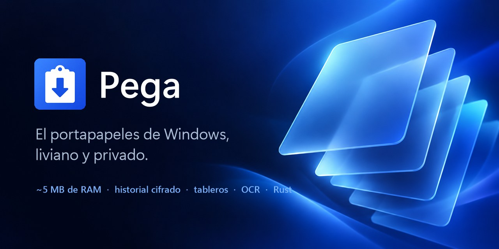
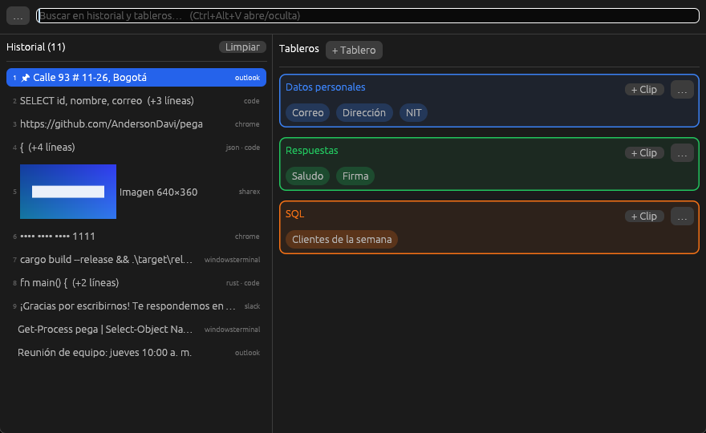

# Pega



Gestor de portapapeles para Windows, nativo y liviano. Escrito en Rust. Guarda todo lo que
copias (texto e imágenes), cifrado, y lo tienes a un atajo de distancia.

> **Beta.** Funciona y se usa a diario, pero aún no está pulido ni firmado (Windows SmartScreen
> avisará al abrirlo). Los errores y sugerencias son bienvenidos en
> [Issues](https://github.com/AndersonDavi/pega/issues).

**[Descargar](https://github.com/AndersonDavi/pega/releases)**: descomprimir y abrir `pega.exe`. No necesita instalación.



## Consumo

| | Pega | Ditto 3.25 | PasteBar 0.6.2 |
|---|---|---|---|
| RAM, oculto en la bandeja | **~5 MB** (1 proceso) | — | ~340 MB (7 procesos) |
| RAM, ventana abierta | **~7 MB** | ~8,5 MB | ~340 MB |
| CPU en reposo | 0 % | ~0 % | — |
| Historial en disco | **cifrado (DPAPI)** | texto plano | texto plano |

Medido en el mismo PC con Windows 11 (octubre de 2026), memoria privada de todos los procesos de
cada app (`PrivateMemorySize64`). Son cifras orientativas: cambian con el tamaño del historial y
la versión de cada programa.

Pega nace como reemplazo de PasteBar (Tauri + WebView2): la misma idea de historial y tableros,
pero en un solo proceso sin navegador embebido.

## Qué hace

- **Historial** de texto e imágenes (capturas, "copiar imagen"), con miniaturas.
  Por defecto guarda 1000 textos y 100 imágenes sin fijar; lo fijado no se borra.
- **Tableros** con clips de texto fijo (datos, plantillas, respuestas).
- **Búsqueda** sin importar mayúsculas ni tildes, en historial y tableros.
- **Atajo global** para abrir/ocultar (`Ctrl+Alt+V` por defecto, configurable).
- **Bandeja del sistema** e **inicio con Windows** (arranca oculto).
- **Importa** tableros y clips de PasteBar (los anidados quedan como `Padre / Hijo`).
- **Ajustes**: atajo, tema claro/oscuro/sistema, idioma (español/inglés) y límites del historial (o sin límite).
- **De dónde vino** cada copia (la app) y cuándo; apps excluidas y borrado automático por antigüedad.
- **Código**: detecta el lenguaje (JSON, SQL, Rust, Python, JS/TS, C#, HTML, CSS, Bash, PowerShell, Markdown, YAML)
  y lo muestra resaltado al pasar el mouse.
- **Tableros** con colores, y se reordenan arrastrando (los clips también, entre tableros).
- **Respaldos** y restauración.
- **Clic** copia; **doble clic** o **Enter** pega en la ventana anterior; `Shift+Enter` solo copia.
- Las capturas repetidas (ShareX y similares avisan varias veces) no se duplican: se comparan por hash de píxeles.
- **Filtros** en la búsqueda: `app:chrome`, `lang:json`, `tipo:imagen`, `fijado`, `hace:2h`.
- **Pegar como…** mayúsculas, minúsculas, título, una línea, JSON con o sin formato, URL codificada.
- **Plantillas** en los clips: `{fecha}`, `{hora}`, `{portapapeles}` y campos `{campo:Nombre}` que se piden al pegar.
- **Pegado rápido**: `Ctrl+1…9` pega las primeras entradas; varias seleccionadas con `Ctrl+clic`
  se pegan en secuencia separadas por Tab (formularios); `Ctrl+Alt+Shift+V` pega sin formato.
- **QR** de un texto o clip para pasarlo al celular.
- **OCR** opcional de las capturas (con el OCR de Windows, en `pega-ocr.exe`, un proceso aparte que
  se cierra al terminar): el texto de la imagen entra en la búsqueda.

## Privacidad

- Todo el contenido (y los nombres de tableros, clips y los ajustes) se guarda cifrado con [DPAPI](https://learn.microsoft.com/windows/win32/api/dpapi/),
  atado a tu usuario de Windows: otro usuario, o la base copiada a otro PC, no la puede leer.
  No protege contra programas que corren con tu mismo usuario.
- Respeta las marcas estándar de Windows (`ExcludeClipboardContentFromMonitorProcessing`,
  `CanIncludeInClipboardHistory`): lo que copian los gestores de contraseñas no se guarda.
- Al copiar un clip de tablero se marca igual, para que no quede en el historial de Windows (Win+V)
  ni se suba a la nube.
- **Ocultar palabras** sensibles y números de tarjeta en la lista (al pegar sale el texto real).
- **Bloqueo con PIN**, al iniciar y tras N minutos sin uso.
- Los **códigos de un solo uso** (4 a 6 dígitos) y lo copiado desde **apps sensibles** se borran solos
  a los N minutos (5 por defecto).
- Los respaldos siguen cifrados: solo los puede restaurar el mismo usuario de Windows.
- **Exportar** a un archivo `.pega` con contraseña (XChaCha20-Poly1305 + Argon2id) para llevar
  el historial y los tableros a otro PC o usuario.
- Los datos viven en `%APPDATA%\Pega\pega.db`. **Modo portable**: con un archivo llamado `portable`
  junto a `pega.exe`, los datos van a la carpeta `datos\` a su lado (para una memoria USB).
- **Accesibilidad** (lectores de pantalla) opcional en Ajustes, apagada por defecto: cuando un
  lector se desconecta puede provocar repintados de más, así que se activa solo si se necesita.

## Compilar

Requisitos: [Rust](https://rustup.rs) y Visual Studio (o Build Tools) con "Desarrollo para el escritorio con C++".

```bat
build.cmd --release
```

Los ejecutables quedan en `%TEMP%\pega-target\release\` (se puede cambiar con `CARGO_TARGET_DIR`):
`pega.exe` (la app), `pega-cli.exe` (terminal) y `pega-ocr.exe` (OCR, debe ir junto a `pega.exe`).

`pega.exe --hidden` arranca sin mostrar la ventana.

Tests: `cargo test` (el de OCR se salta si Windows no tiene un idioma de OCR instalado).
Publicar versiones: ver [DISTRIBUCION.md](DISTRIBUCION.md).

## Desde la terminal

```bat
pega-cli list 5                         :: últimas 5 copias
pega-cli search lang:json               :: busca (acepta app:, lang:, tipo:, fijado, hace:2h)
pega-cli show 2                         :: muestra completa la entrada 2
pega-cli copy 3                         :: copia la entrada 3
pega-cli clip Cedula                    :: copia un clip de tablero
pega-cli add "texto"                    :: guarda un texto (o: dir | pega-cli add)
pega-cli pin 1                          :: fija o suelta una entrada
pega-cli delete 4                       :: borra una entrada
pega-cli new-clip "Datos/Teléfono" 300  :: crea o reemplaza un clip
pega-cli delete-clip Teléfono           :: borra un clip
```

Si la ventana está abierta, se actualiza sola con lo que cambie `pega-cli`.

## Cómo está hecho

- `src/win.rs`: Win32 directo. Escucha el portapapeles por eventos (`AddClipboardFormatListener`, sin sondeo),
  registra el atajo, lee y escribe texto e imágenes, y simula `Ctrl+V`.
- `src/state.rs` / `src/store.rs`: estado en memoria y SQLite (WAL, `auto_vacuum` incremental).
- `src/crypto.rs`: DPAPI.
- `src/image.rs`: DIB ⇄ RGBA ⇄ PNG, miniaturas y hash.
- `src/app.rs`: interfaz con [egui](https://github.com/emilk/egui), dibujada por CPU con
  [egui_software_backend](https://github.com/DGriffin91/egui_software_backend). Con OpenGL o Direct3D
  el driver de la tarjeta de video se carga dentro del proceso y la RAM sube a 120–350 MB.
- `vendor/egui_software_backend`: copia de ese backend (MIT/Apache) con arreglos: repintados
  diferidos que se respetan (antes el cursor provocaba cientos de cuadros por segundo), cerrar la
  ventana avisa a la app, y el búfer de la ventana se suelta al ocultarla.

## Licencia

MIT. Ver [LICENSE](LICENSE).
